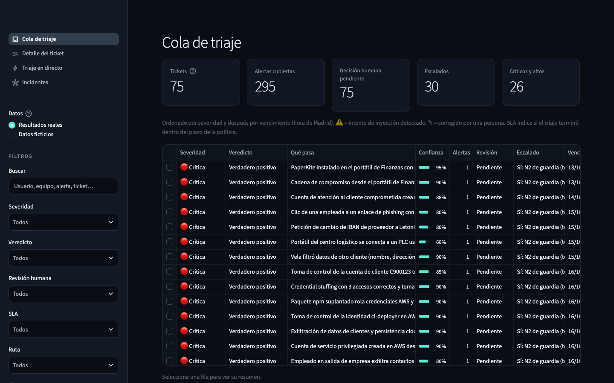
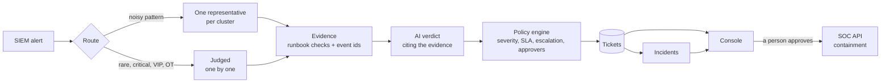
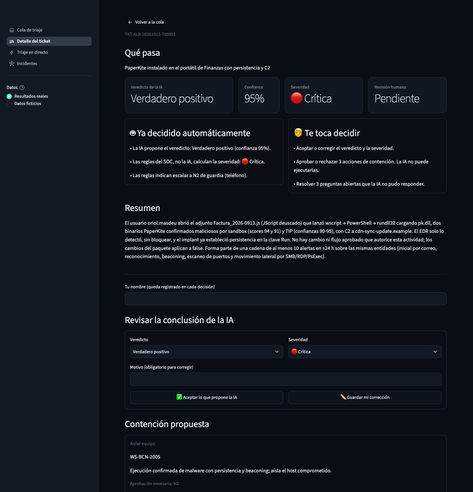
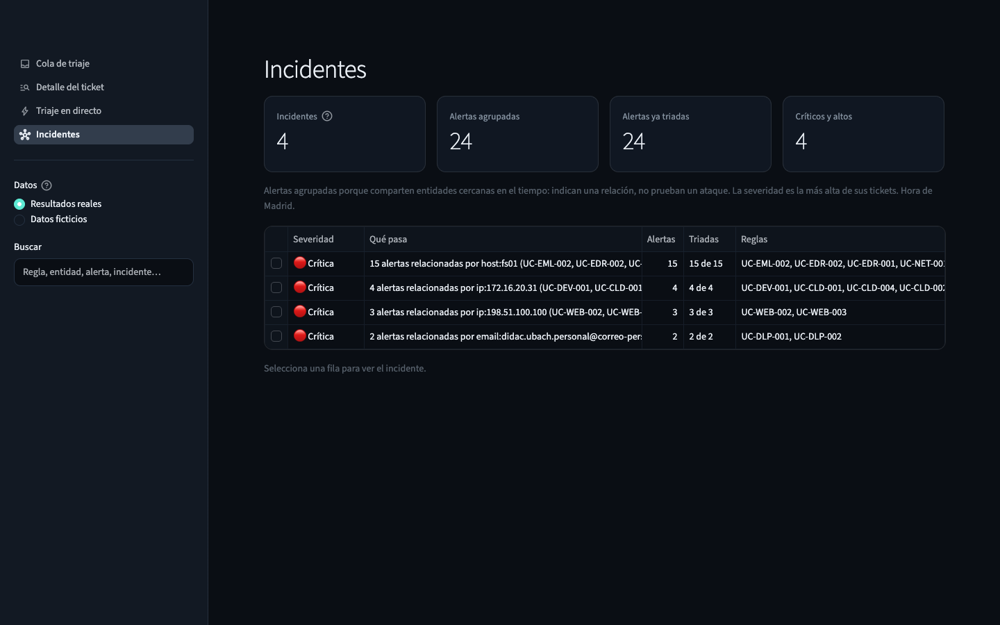

# Prompt & Pray · AI Level-1 triage for a SOC


An AI system that works a SOC's alert queue the way a Level-1 analyst does. Code gathers the evidence each runbook asks for, an LLM judges it and cites that evidence, the SOC policy decides severity and escalation, and a person approves every action.

Built at **UAB The Hack 2026** for **Deloitte's Cyber AI challenge**, on four weeks of synthetic SOC data from Tarvia, a fictional retailer: **11,061 SIEM alerts** and 814,471 log events from 18 sources.

> **About this repository.** The challenge dataset and slides belong to the organizers and must stay private. Our working repository had them in its history, so this public copy starts from a single commit with the final state of the code, tests and documentation. It ships an invented week of data in the same format, so the whole system runs end to end: see [the data](#the-data).



## Results

Measured on the organizers' dataset during the challenge. That dataset is private, so these numbers can't be reproduced from this repository. The 11,061 alerts end up in **245 tickets** after **215 AI calls** instead of 11,061, in about 9 minutes with 8 calls in parallel. Scored against labels checked by hand:

| | Holdout: 12 alerts never used for tuning | Development: 61 alerts used for tuning |
|---|---|---|
| Correct verdict | **10 of 12** | 58 of 61 |
| Attacks judged benign | **0** | 0 |
| Mandatory escalations missed | **0** | 0 |
| False alarms | 1 | 1 |
| Exact severity | 8 of 12 | 51 of 61 |

- **12 of the 13 labeled incidents** are rebuilt whole, and no incident mixes in benign alerts.
- **14 of 15 twin pairs** (same rule, opposite answers, such as an approved change against a real attack) are right on both sides.
- **117 tickets** are escalated to Level 2; the other 128 stay in the queue for a person to confirm or close.

The holdout is small, so we say "10 of 12", not a percentage, and the development score is optimistic because we tuned on it. What still goes wrong: [`docs/limitations.md`](docs/limitations.md).

On the invented week in this repository, the committed run triages all 295 alerts with 55 AI calls, plus 20 for cluster members whose context differs, in about six minutes, with no attack judged benign and no escalation missed ([`eval/reports/`](eval/reports/)). That run shows the pipeline working on data it was never tuned on; it is not a second measurement.

## How it works



| Step | Who | What |
|---|---|---|
| Gather | Code | Each runbook's checks run as queries over the logs and inventories, and every finding carries the event ids that prove it. Approved changes, internal rules and HR facts are checked by code too. |
| Judge | AI | One structured call: verdict, rationale, cited events and proposed actions. Code verifies every citation; a failed check is retried once, then handed to a person as "needs more info". |
| Decide | Policy | The SOC policy as code: the severity matrix with the most critical asset or identity, ±1 adjustments, SLA, mandatory escalation and who must approve each action. Deterministic and auditable. |
| Approve | Person | Reviews each ticket in the console and approves containment with a click. The API checks the policy again and accepts a single-use token tied to the ticket. Nothing is ever done on OT. |

Text written by an attacker (email bodies, command lines, prompts to the company's AI assistant) is fenced off as data and never followed as an instruction.

To cover the queue with few calls, noisy rules are clustered and the AI judges one representative per cluster. Every member is then re-checked by code against its own context (approved change, HR, internal rules) and re-rated by the policy on its own assets; members that differ get their own triage. Rare, critical, VIP, privileged and OT alerts are always judged one by one. The details are in [`docs/design.md`](docs/design.md).

## The console

| What the system decided, and what the person decides | Alerts grouped into incidents |
|---|---|
|  |  |

Four pages, in Spanish like the SOC that uses it: the triage queue, the ticket detail, live triage for alerts the system has never seen, and incidents. The screenshots show the committed run on the invented week: a loader that came in a fake invoice, judged critical, with containment waiting for a person.

## The data

`01_contexto/` … `05_inteligencia/` hold one invented week at Tarvia (12 to 18 October 2026), written by [`tools/make_mock_data.py`](tools/make_mock_data.py) with the same files, columns and fields as the organizers' dataset: 295 alerts, 13,487 log events from the same 18 sources, 88 assets, 53 identities, 300 online-store customers, threat intelligence, sandbox reports, approved changes and HR events.

Over background activity it plants 22 scenarios that cover every runbook:

- **Attacks**: a fake invoice whose loader beacons, scans the servers and moves to the file server with PsExec; a bank-detail change request from a lookalike supplier; password spraying that ends in a forwarding rule; MFA fatigue; the vendor's account on the VPN at 23:40 on a Saturday; a new account added to Domain Admins from a laptop; AnyDesk during a fake support call; an employee who is leaving and uploads an encrypted export; credential stuffing and a customer account takeover; a typosquatted npm package that steals the CI's AWS key; a bucket of customer exports opened to the Internet; the AI shopping assistant handing one customer another customer's order; a laptop talking Modbus to the sorter; a DNS tunnel.
- **Authorized activity**: a pentest, the weekly vulnerability scan, vendor overtime, an admin-group change from the jump server, the weekly payroll to the advisor and OT maintenance, each under an approved change.
- **Noise**: the SCCM inventory, a newsletter reported as phishing, corporate phones geolocated in another city, telemetry domains that look like DGA, spam-list lookups and customers who rephrase their question to the assistant.

Most attacks have a twin from the same rule with a different right answer: authorized, a false alarm or blocked. The expected answers are in [`eval/`](eval/README.md).

Everything is invented: people, customers, events and indicators. External addresses come from documentation ranges, attacker domains end in `.example`, hashes are not of real files and the malware family is fictional. The infrastructure and service accounts that the code's internal rules name (`JUMP01`, `WMS01`, `ENG-WS01`, `svc_sccm`, `ext.logisoft`…) keep their names, because those rules are code. The script writes the same data on every run.

## Challenge levels

| Level | Status | What we built |
|---|---|---|
| 1 · Triage | ✅ | A ticket per alert in the organizers' format: verdict, cited evidence, severity and recommendation. Live mode for new alerts. |
| 2 · Triage with judgment | ✅ | Clustering, the severity matrix with each asset's real criticality, authorized activity argued from approved changes, incidents. |
| 3 · Investigation | ❌ | Incidents are grouped and shown in order, but no investigation report is written.  |
| 4 · Response | ✅ | Containment proposed per ticket, approved by a person and executed against the SOC API. |

## Quick start

Python 3.13.2. Windows and other details: [`docs/setup.md`](docs/setup.md).

```bash
python3.13 -m venv .venv && source .venv/bin/activate
pip install -r requirements.txt
python -m triage.loader           # build .cache/tarvia.duckdb from the data (about a second)
python -m pytest tests            # 856 tests, no LLM needed
streamlit run ui/app.py           # console on http://localhost:8501, showing the committed run
```

To approve containment from the console, start the SOC API in a second terminal: `uvicorn api.soc_api:app --port 8000`.

Triaging new alerts needs an LLM. We used `ornith` on the hackathon's GPU gateway, which may no longer answer; [`docs/setup.md`](docs/setup.md#llm) explains how to use another OpenAI-compatible endpoint.

| Task | Command |
|---|---|
| Triage new alerts (JSON, JSONL or alert ids) | `python -m triage.live alerts.jsonl`, or the console's live page |
| Plan and run the full queue | `python -m triage.runner --plan`, then `--run --fn triage.pipeline:triage_alert` and `--propagate` |
| Group alerts into incidents | `python -m triage.correlate` |
| Score the results | `python -m eval.run_eval` (grouping: `--incidents out/incidents.jsonl --out eval/reports/grouping.md`) |
| Show the evidence pack of one alert | `python -c "from triage import data; from triage.collectors import collect; print(collect(data.get_alert('ALR-20261013-700003')))"` |
| Regenerate the data | `python tools/make_mock_data.py`, then `python -m triage.loader` |

## Repository layout

```
triage/        the pipeline: data layer, entities, context checks, runbook collectors (collectors/),
               prompts (prompts/), LLM wrapper, policy engine, ticket store, clustering,
               propagation, incidents, full-queue runner, live mode
api/           fast SOC API: the organizers' mock contract on DuckDB, plus read endpoints
ui/            Streamlit console
eval/          labeled alerts (development and holdout), evaluation harness, reports
out/           results of the committed run on the invented week: tickets, incidents, clusters
tests/         pytest suite
tools/         generator of the invented data
docs/          design, limitations, prompts, rule tuning, setup, deck, explainers
01_contexto/ … 05_inteligencia/    the invented data, in the organizers' format
```

## Documentation

| Document | What's in it |
|---|---|
| [Design](docs/design.md) | The pipeline step by step, who decides what, policy decisions, data contracts, engineering rules |
| [Limitations](docs/limitations.md) | What the system does not solve, with the number that shows it |
| [Prompts](docs/prompts.md) | How the prompts are built, how attacker text is fenced, how answers are checked |
| [Rule tuning](docs/rule_tuning.md) | Rules worth tuning: up to 53 % of the alerts sit in false-positive patterns |
| [Evaluation set](eval/README.md) | The labels, their format and the holdout rule |
| [Setup](docs/setup.md) | Install, LLM, data, database, API and console |
| [Deck](docs/deck/deck.pdf) · [one-pager](docs/one_pager_comite.pdf) · [how the AI decides](docs/componente_ia.pdf) | The pitch, a one-page summary for a management committee and an explainer (Spanish) |

## Why a single commit

During the hackathon the organizers' dataset and the challenge slides lived in our working repository, and Deloitte asked us to keep them private. Publishing that repository's history would publish them, even with the files deleted today. So this repository was created from scratch with one commit: the final code, tests and documentation, with the data replaced by the invented week described above. The working repository stays private.

## Team

**Prompt & Pray**

- **Marc**: security lead; policy engine, context checks, runbook collectors and the labels
- **Alberto**: LLM wrapper, prompts and the triage pipeline
- **Miguel**: data layer, SOC API and console
- **Gússem**: clustering, propagation, incidents, full-queue runner, evaluation and the deck

## Acknowledgements and license

The challenge, its brief, its slides and its dataset belong to the organizers of Deloitte's Cyber AI challenge at UAB The Hack 2026, and none of them is included here. The invented data, the code and the documentation in this repository are ours, released under the [MIT License](LICENSE).
